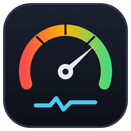
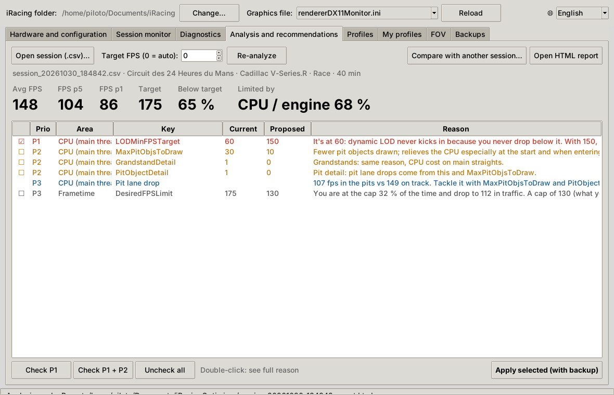
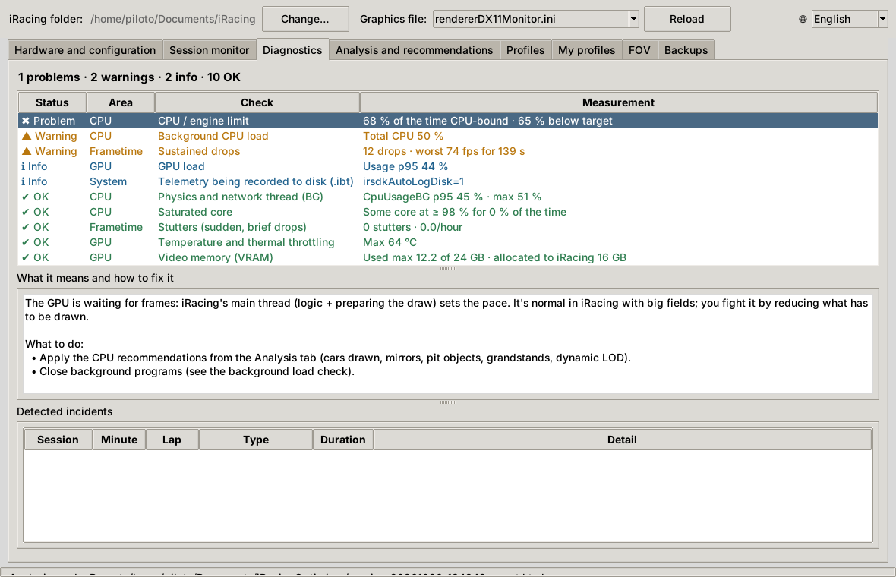
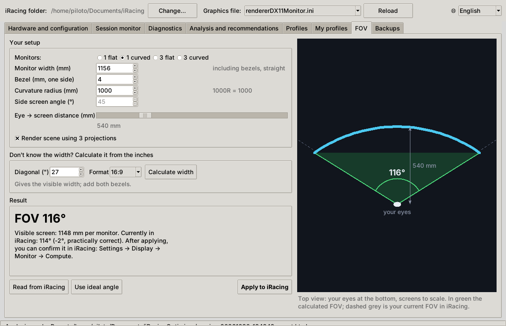
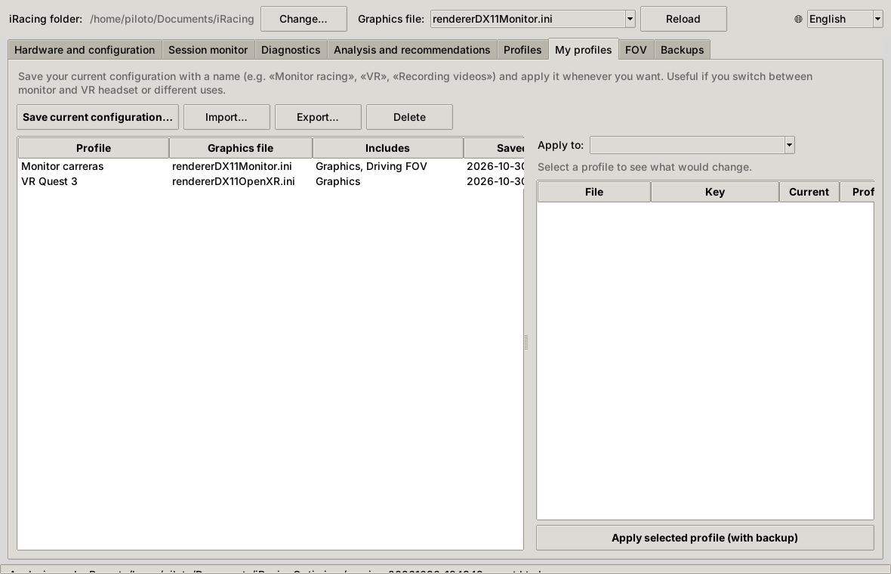
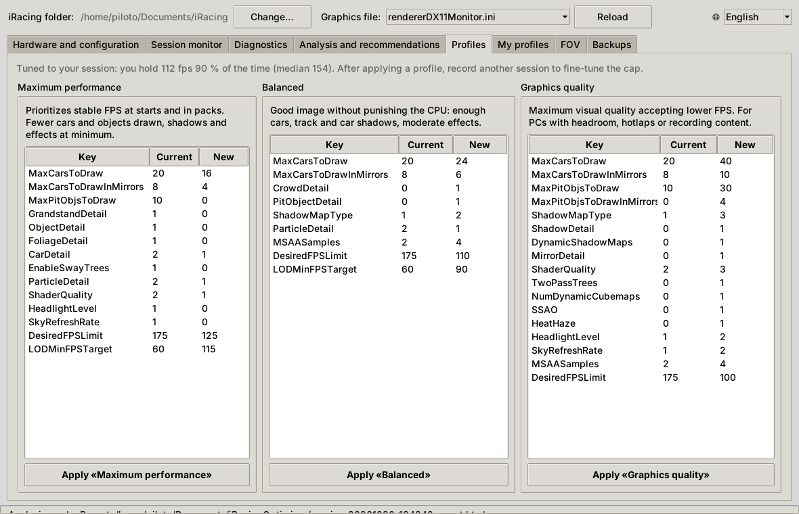

<p align="center"></p>

# iRacing Optimizer

**English** · [Español](README.md)

iRacing Optimizer reads your iRacing and PC configuration and records a session (a race works best). From that it tells you **what is limiting you** (CPU/engine, GPU or the FPS cap) and proposes specific values for your `.ini` files. Changes are applied with one click, and a backup is always made first.



<details>
<summary>More screenshots</summary>

**Diagnostics**



**FOV** (single curved monitor)



**My profiles** (monitor and VR)



**Profiles** (tuned to the measured session)



</details>

## Download

Download `iRacingOptimizer.exe` from **[Releases](../../releases)** and run it. No installation or Python required.

> Windows SmartScreen may show a warning because the executable is not code-signed: click "More info → Run anyway". You can verify the file is the original using the `SHA256SUMS.txt` included in the release or its build provenance attestation (`gh attestation verify`, see [SECURITY.md](SECURITY.md)). For what the app does and doesn't do (no internet connection except the optional update notice, no admin rights, only touches iRacing's `.ini` files and always backs them up first), see [SECURITY.md](SECURITY.md).

The interface is available in **English and Spanish**. It follows your Windows language by default; you can switch it with the 🌐 selector at the top right (restart required).

## Features

1. **Hardware and configuration**: detects the `Documents\iRacing` folder, the graphics file (`rendererDX11Monitor.ini`, or OpenXR for VR), CPU, GPU, RAM and display. It also **warns you if iRacing** (for example after an update) **or you, from inside the sim, changed settings the app had applied**, and lets you re-apply them or keep the new ones.
2. **Session monitor** (with optional **PresentMon** for real frame-by-frame frametimes): click *Start recording*, get on track (a full race is ideal) and click *Stop* when you're done.
   - While recording it shows FPS, GPU, physics/network thread, latency and nearby cars live, and warns you immediately about stutters, latency spikes, packet loss, a saturated physics thread or a hot GPU.
   - With PresentMon you get real 1 % / 0.1 % lows and millisecond stutters, each with its lap position and whether the CPU or the GPU caused it.
   - The first time, it may ask for a Windows permission (see [SECURITY.md](SECURITY.md)).
3. **Diagnostics**: checks each area (CPU, GPU, frametime, network, memory, system) and marks it OK, warning or problem. For each check it explains what it means and what to do, and lists incidents with their minute and lap position.
4. **Analysis and recommendations**: average FPS, the worst 5 % and 1 %, time below target, what limits you, FPS loss with nearby traffic, and the slowest sections of the track. It gives a list of prioritized changes (P1 apply now, P2 recommended, P3 optional): tick the ones you want and click **Apply selected**. An HTML report with charts is also generated.
5. **Profiles**: three starting presets (Maximum performance, Balanced, Graphics quality). If you've analyzed a session, the FPS cap and dynamic LOD are tuned to your measurement. Each profile shows exactly what it will change before applying.
6. **My profiles**: save your current configuration under a name ("Monitor racing", "VR", "Recording videos"…) and apply it whenever you need it.
   - You choose what to save: graphics, display/monitors and FOV.
   - Each profile remembers its graphics file (`rendererDX11Monitor.ini` for monitor, `rendererDX11OpenXR.ini` for VR), so switching between monitor and headset is one click.
   - Profiles can be exported and imported to share them.
7. **FOV**: visual calculator for 1 flat or curved monitor and for flat or curved triples.
   - It uses the same measurements iRacing asks for: width including bezels measured straight, bezel on one side, side screen angle or curvature radius, and eye-to-screen distance.
   - It draws a top view of your rig with the resulting FOV, compares it with your current iRacing FOV, computes the ideal side screen angle and applies everything (`[MonitorSetup]` + `drivingCamFOV`).
   - You can confirm the result afterwards with *Compute* in iRacing's Monitor menu.
8. **Compare**: in Analysis, *Compare with another session…* puts the new session against an earlier one. It shows FPS by nearby traffic, which is a fair comparison even between a practice and a race, and which settings changed between the two.
9. **Backups**: list backups and restore any of them with one click.

Apply changes **with iRacing closed**: the sim rewrites its `.ini` files on exit. The app checks this before writing.

**Recommended workflow:**
1. Record a race.
2. Apply the P1 recommendations.
3. Record another race on the same track.
4. Compare the two sessions.
5. Set your FPS cap to what you hold 90 % of the time.

## What it measures

| Source | Data |
|---|---|
| iRacing SDK (4 Hz) | `FrameRate`, `CpuUsageFG/BG`, network (`ChanLatency`, `ChanQuality`, `ChanPartnerQuality`, `ChanClockSkew`), page faults, telemetry disk logging, lap position and cars within 150 m |
| PresentMon (optional) | Every frame: frametime, CPU busy and GPU busy, with absolute timestamps aligned to the telemetry |
| NVIDIA driver (NVML) | Real GPU usage, VRAM, temperature, clocks, power and throttle reasons (thermal or power) |
| Disk | Read and write MB/s (to detect stutters caused by texture loading) |
| System | Per-core and total CPU, RAM, iRacing process memory and the processes using the most CPU while you drive |
| `.ini` | `rendererDX11*.ini`, `app.ini`, `core.ini` (only keys that already exist are modified) |

How the bottleneck is classified, using real GPU load:
- At **90 % or more**, the GPU is the limit.
- **Below 80 %**, the GPU is waiting for frames and the limit is the CPU/engine (main thread, draw calls).
- With PresentMon, the classification is also done frame by frame from CPU and GPU busy times.

## Virtual reality

For headset sessions (Quest, Index, Pimax…), tick **VR session** in the Monitor tab and pick your headset and refresh rate. Meta Quest Link, Virtual Desktop, SteamVR and ALVR are detected automatically when running.

- The target becomes the **headset refresh rate** (72/80/90/120 Hz), not an FPS cap.
- **Reprojection** (ASW, Motion Smoothing, SSW) is detected: FPS locked at half the refresh rate.
- Diagnostics show the active OpenXR runtime and tips for it.
- Profiles built on `rendererDX11OpenXR.ini` set dynamic LOD to the headset refresh rate.
- PresentMon is not used in VR: it would measure the monitor mirror window, not the headset.

## New version notice

The first time you open the app it asks whether you want to be notified of new versions. The default is no. You can change it with the **Notify me of new versions** checkbox.

If enabled, every time you open the app it checks this repository's GitHub releases page. When there is a new version, a bar shows *What's new*, *Download* and *Skip this version*. The app never updates itself or downloads anything: you download it yourself from GitHub. To turn it off completely, set `IROPT_NO_UPDATE_CHECK=1`.

## Sharing sessions

**Analysis → Export to share…** creates an anonymised `.zip`. It includes the telemetry, hardware (without the OS) and only graphics/display settings. It does not include process names, paths, or audio/controls settings.

To open someone else's `.zip`, use **Open session**. It is copied to `recibidas\` and analysed like your own.

## Command line

The same `.exe`, or `python -m iroptimizer`, accepts subcommands:

```
iRacingOptimizer.exe scan
iRacingOptimizer.exe monitor --analyze --presentmon
iRacingOptimizer.exe analyze session.csv [--target 165] [--presentmon pm.csv]
iRacingOptimizer.exe apply session.recs.json --max-priority 1 [--dry-run]
iRacingOptimizer.exe profile equilibrado [--from-session session.csv] [--dry-run]
iRacingOptimizer.exe monitor --vr-hz 90
iRacingOptimizer.exe export session.csv [--out session_share.zip]
iRacingOptimizer.exe compare before.csv after.csv
iRacingOptimizer.exe check-update
iRacingOptimizer.exe restore
iRacingOptimizer.exe demo
```

Profile names on the command line: `rendimiento` (performance), `equilibrado` (balanced), `calidad` (quality). To force a language, set `IROPT_LANG=en` or `IROPT_LANG=es`.

## Development

```bat
py -m pip install -r requirements.txt pytest
py -m pytest -q tests
py app.py            :: GUI
build.bat            :: builds dist\iRacingOptimizer.exe (put PresentMon in tools\PresentMon.exe first)
```

GitHub Actions builds the `.exe` on every push to `main`. The build:
- runs the tests, static analysis (bandit) and a dependency audit (pip-audit);
- downloads PresentMon from Intel's official release and checks its digital signature before bundling it.

Publishing a Release builds the executable and attaches it with its `SHA256SUMS.txt`.

**Translations**: UI text is written in Spanish in the code and wrapped with `_()`. English strings live in `iroptimizer/locale_en.py`, keyed by the Spanish template. A test checks that every string has a translation and that the placeholders match.

## Limitations

- Thresholds are calibrated with few sessions so far (7800X3D + RTX 4090). On AMD Radeon there's no GPU load data from the driver (no NVML), so the classification is less reliable. PresentMon helps in that case.
- The SDK FPS value is a 1-second average; use PresentMon for real frametimes.
- Profiles don't touch keys with undocumented ranges (e.g. `SSRLevel`) and never remove mirrors.
- Not affiliated with iRacing.com Motorsport Simulations.

## License

MIT. Third-party components: see [THIRD_PARTY_NOTICES.md](THIRD_PARTY_NOTICES.md).
