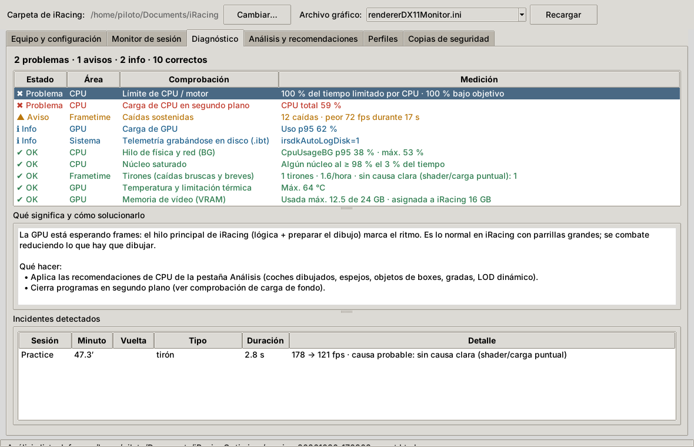
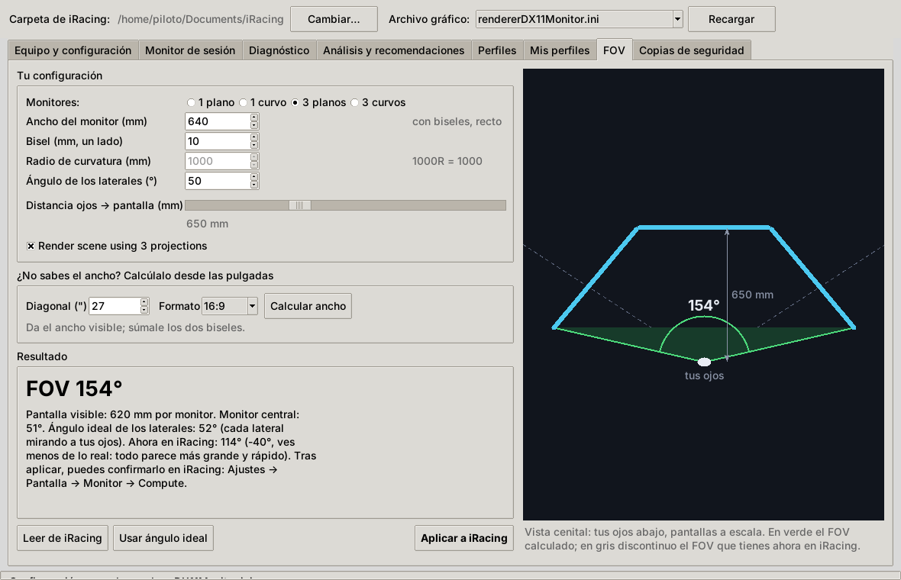
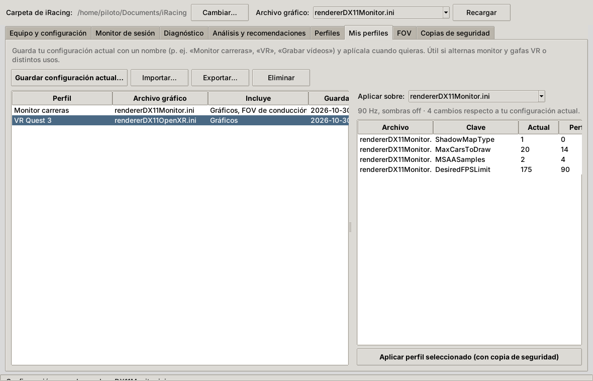

<p align="center"></p>

# iRacing Optimizer

[English](README.en.md) · **Español**

Lee tu configuración de iRacing y de tu equipo y graba una sesión (mejor si es una carrera). Con eso te dice **qué te limita** (CPU/motor, GPU o el tope de FPS) y propone valores concretos para los `.ini`. Los cambios se aplican con un botón y siempre se guarda antes una copia de seguridad.


<details>
<summary>Más capturas</summary>

**Diagnóstico**



**FOV** (triples planos con ángulo ideal)



**Mis perfiles** (monitor y VR)



**Perfiles** (ajustados a la sesión medida)


**Informe HTML** (sesión real: carrera en Le Mans, 7800X3D + RTX 4090, 5120×1440)


**Equipo y configuración**


</details>

## Descarga

Descarga `iRacingOptimizer.exe` desde **[Releases](../../releases)** y ejecútalo: no necesita instalación ni Python.

> Windows SmartScreen puede avisar porque el ejecutable no está firmado. Pulsa "Más información → Ejecutar de todas formas". Puedes comprobar que el archivo es el original con el `SHA256SUMS.txt` de la release o con su atestación de procedencia (`gh attestation verify`, ver [SECURITY.md](SECURITY.md)). Qué hace y qué no hace la app (sin conexión a internet salvo el aviso opcional de versiones, sin permisos de administrador, solo toca los `.ini` de iRacing y siempre con copia): ver [SECURITY.md](SECURITY.md).

La interfaz está en **español e inglés**: sigue el idioma de Windows y se puede cambiar con el selector 🌐 de arriba a la derecha (requiere reiniciar).

## Uso

1. **Equipo y configuración**: avisa si iRacing (por ejemplo tras una actualización) o tú desde el simulador habéis cambiado ajustes que la app había aplicado, y te deja volver a aplicarlos o quedarte con los nuevos. Además detecta la carpeta `Documentos\iRacing`, el archivo gráfico (`rendererDX11Monitor.ini` u OpenXR para VR), la CPU, la GPU, la RAM y la pantalla.
2. **Monitor de sesión** (con **PresentMon** opcional para medir frametimes reales frame a frame): pulsa *Iniciar grabación*, entra a pista (lo ideal es una carrera completa) y pulsa *Detener* al terminar. Durante la grabación muestra en vivo FPS, GPU, hilo de física/red, latencia y coches cerca, y avisa al momento de tirones, picos de latencia, pérdida de paquetes, saturación del hilo de física o GPU caliente. Al acabar, analiza la sesión. Con PresentMon obtienes 1 % / 0,1 % lows reales y tirones de milisegundos, cada uno con su posición en la vuelta y si lo causó la CPU o la GPU. La primera vez puede pedirte un permiso de Windows (ver [SECURITY.md](SECURITY.md)).
3. **Diagnóstico**: revisa por áreas (CPU, GPU, frametime, red, memoria y sistema) y marca cada comprobación como OK, aviso o problema. Para cada una explica qué significa y qué hacer, y lista los incidentes con su minuto y su posición en la vuelta.
4. **Análisis y recomendaciones**: muestra los FPS medios, el 5 % y el 1 % peor, el porcentaje de tiempo bajo el objetivo, qué te limita y una lista de cambios priorizados (P1 aplicar ya, P2 recomendable, P3 opcional). Marca los que quieras y pulsa **Aplicar seleccionados**. Hay un informe HTML con gráficas.
5. **Perfiles**: tres configuraciones de partida (Máximo rendimiento, Equilibrado y Calidad gráfica). Si has analizado una sesión, el tope de FPS y el LOD dinámico se ajustan a tu medición. Cada perfil muestra exactamente qué cambia antes de aplicarlo.
6. **Mis perfiles**: guarda tu configuración actual con un nombre ("Monitor carreras", "VR", "Grabar vídeos"…) y aplícala cuando la necesites. Puedes elegir qué guardar: gráficos, pantalla/monitores y FOV. Cada perfil recuerda su archivo gráfico (`rendererDX11Monitor.ini` para el monitor, `rendererDX11OpenXR.ini` para VR), así que alternar entre monitor y gafas es un clic. Antes de aplicar enseña exactamente qué cambia. Se pueden exportar e importar para compartirlos.
7. **FOV**: calculadora visual para 1 monitor plano o curvo y para triples planos o curvos. Usa las mismas medidas que iRacing: ancho con biseles medido en recto, bisel de un lado, ángulo de los laterales o radio de curvatura, y distancia de los ojos a la pantalla. Dibuja el puesto visto desde arriba con el FOV resultante, lo compara con el que tienes en iRacing, calcula el ángulo ideal de los laterales y lo aplica (`[MonitorSetup]` + `drivingCamFOV`). Después puedes confirmarlo con *Compute* en el menú Monitor de iRacing.
8. **Comparar**: en Análisis, *Comparar con otra sesión…* enfrenta la sesión nueva con una anterior. Muestra los FPS según el tráfico (la comparación justa entre una práctica y una carrera) y qué ajustes cambiaron entre las dos.
9. **Copias de seguridad**: lista las copias y restaura cualquiera con un clic.

Aplica los cambios **con iRacing cerrado**, porque el simulador reescribe los `.ini` al salir. La app lo comprueba antes de escribir.

**Flujo recomendado:** graba una carrera → aplica las P1 → graba otra en la misma pista → compara → fija el tope de FPS con lo que mantienes el 90 % del tiempo.

## Qué mide

| Fuente | Datos |
|---|---|
| SDK de iRacing (4 Hz) | `FrameRate`, `CpuUsageFG/BG`, red (`ChanLatency`, `ChanQuality`, `ChanPartnerQuality`, `ChanClockSkew`), fallos de página, grabación de telemetría a disco, posición en la vuelta y coches a menos de 150 m |
| Driver NVIDIA (NVML) | Uso real de GPU, VRAM, temperatura, frecuencia, consumo y motivos de limitación (térmica o de potencia) |
| Disco | Lectura y escritura en MB/s (para detectar tirones por carga de texturas) |
| Sistema | CPU por núcleo y total, RAM, memoria del proceso de iRacing y los procesos que más CPU consumen mientras conduces |
| `.ini` | `rendererDX11*.ini`, `app.ini`, `core.ini` (solo se modifican claves que ya existen) |

Para saber qué te limita usa la carga real de la GPU:
- Al **90 % o más**, el límite es la GPU.
- Por **debajo del 80 %**, la GPU está esperando frames y el límite es la CPU o el motor (hilo principal, draw calls).

Los FPS del SDK son una media de 1 s. Para medir microstutter (1 % / 0,1 % lows reales), activa PresentMon en el monitor (viene incluido en el `.exe`).
Al terminar, el registro de PresentMon se guarda reducido y comprimido (`.presentmon.csv.gz`, unos 7 MB por hora de carrera en vez de ~100 MB).

## Realidad virtual

Para sesiones con visor (Quest, Index, Pimax…), marca **Sesión en VR** en la pestaña Monitor y elige visor y frecuencia. Si Meta Quest Link, Virtual Desktop, SteamVR o ALVR están abiertos, se detectan solos.

- El objetivo pasa a ser la **frecuencia del visor** (72/80/90/120 Hz), no un tope de FPS.
- Se detecta la **reproyección** (ASW, Motion Smoothing, SSW): cuando los FPS se quedan en la mitad de la frecuencia.
- El diagnóstico muestra el runtime OpenXR activo y consejos para él.
- Los perfiles generados sobre `rendererDX11OpenXR.ini` ajustan el LOD dinámico a la frecuencia del visor.
- PresentMon no se usa en VR: mediría la ventana espejo del monitor, no el visor.

## Aviso de nuevas versiones

La primera vez que abres la app te pregunta si quieres que te avise de versiones nuevas. Por defecto, no. Puedes cambiarlo con la casilla **Avisar de nuevas versiones**.

Si lo activas, cada vez que abres la app consulta la página de releases de este repositorio en GitHub. Si hay versión nueva, muestra una barra con *Ver novedades*, *Descargar* e *Ignorar esta versión*. La app nunca se actualiza sola ni descarga nada: la descarga la haces tú desde GitHub. Para desactivarlo del todo, define `IROPT_NO_UPDATE_CHECK=1`.

## Compartir sesiones

**Análisis → Exportar para compartir…** crea un `.zip` anonimizado. Incluye la telemetría, el hardware (sin el sistema operativo) y solo los ajustes gráficos y de pantalla. No incluye nombres de procesos, rutas, ni ajustes de audio o controles.

Para abrir el `.zip` de otra persona, usa **Abrir sesión**. Se copia a `recibidas\` y se analiza como una sesión propia.

## Línea de comandos

El mismo `.exe`, o `python -m iroptimizer`, acepta subcomandos:

```
iRacingOptimizer.exe scan
iRacingOptimizer.exe monitor --analyze --presentmon
iRacingOptimizer.exe analyze sesion.csv [--target 165] [--presentmon pm.csv]
iRacingOptimizer.exe apply sesion.recs.json --max-priority 1 [--dry-run]
iRacingOptimizer.exe profile equilibrado [--from-session sesion.csv] [--dry-run]
iRacingOptimizer.exe monitor --vr-hz 90
iRacingOptimizer.exe export sesion.csv [--out sesion_compartir.zip]
iRacingOptimizer.exe compare antes.csv despues.csv
iRacingOptimizer.exe check-update
iRacingOptimizer.exe restore
iRacingOptimizer.exe demo
```

## Desarrollo

```bat
py -m pip install -r requirements.txt pytest
py -m pytest -q tests
py app.py            :: interfaz
build.bat            :: genera dist\iRacingOptimizer.exe
```

Los tests incluyen **sesiones reales anonimizadas** (`tests/fixtures/real`: Le Mans con directo, VR a 72 Hz, Hungaroring y Monza con PresentMon). Cada una fija un fallo que apareció en uso real, para que no vuelva. Se generan con `tests/fixtures/build_real.py`.

GitHub Actions compila el `.exe` en cada push a `main`; está disponible como *artifact* del workflow. Al publicar una Release (o subir una etiqueta `vX.Y.Z`), el workflow compila y adjunta el ejecutable:

```
gh release create v0.9.5 --generate-notes
```

### Estructura

```
app.py                  entrada del .exe (GUI sin argumentos, CLI con argumentos)
assets/                 logo (SVG), icono .ico y .png
docs/                   capturas del README
iroptimizer/
  gui.py                interfaz tkinter
  monitor.py            grabación (pyirsdk + psutil + NVML)
  analyzer.py           estadísticas, cuellos de botella, tráfico, zonas lentas
  diagnostics.py        comprobaciones por área, incidentes y alertas en vivo
  recommender.py        reglas → cambios priorizados
  profiles.py           perfiles Rendimiento / Equilibrado / Calidad
  userprofiles.py       perfiles guardados por el usuario (monitor, VR…)
  fov.py                geometría del FOV (plano, curvo, triples)
  apply.py              aplicar, copias y restaurar
  presentmon.py         captura y análisis de frametimes con PresentMon
  drift.py              detección de cambios respecto a lo aplicado
  safety.py             validaciones de seguridad (lista blanca de archivos, valores, rutas)
  iniio.py              lectura/escritura de .ini conservando comentarios
  config_reader.py      localiza Documentos\iRacing (respeta OneDrive)
  hardware.py           inventario del equipo
  report.py             informe HTML
  i18n.py, locale_en.py traducción (textos en español con _(), catálogo en inglés)
```

## Limitaciones

- Umbrales calibrados con pocas sesiones (por ahora 7800X3D + RTX 4090). Para AMD Radeon no hay datos de carga de GPU (sin NVML), así que la clasificación es menos fiable.
- Los perfiles no tocan claves con rangos no documentados (por ejemplo `SSRLevel`) ni quitan espejos.
- No está afiliado a iRacing.com Motorsport Simulations.

## Licencia

MIT. Componentes de terceros: ver [THIRD_PARTY_NOTICES.md](THIRD_PARTY_NOTICES.md).
