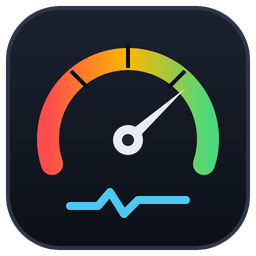
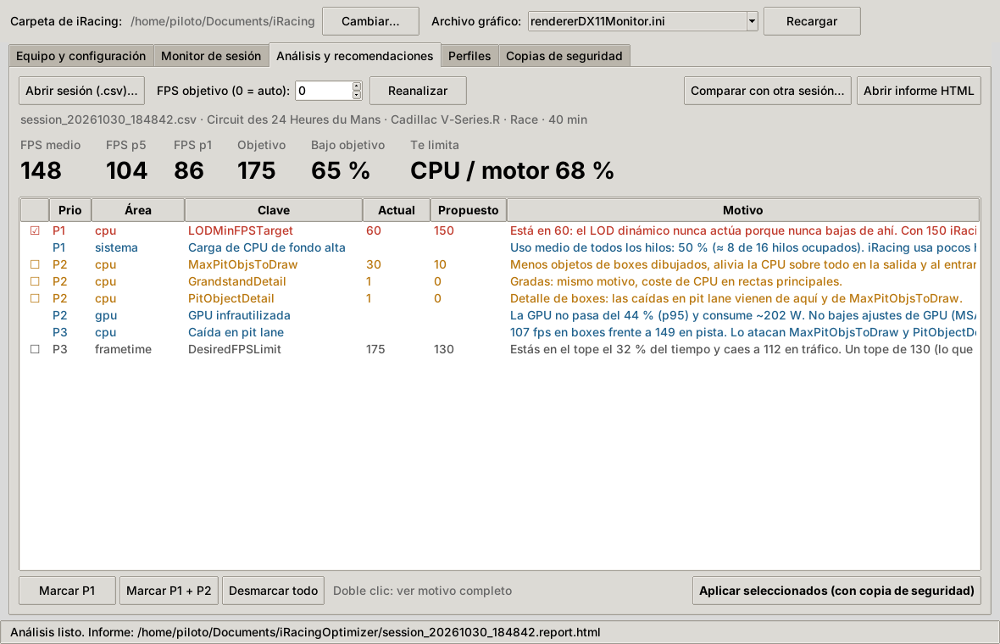
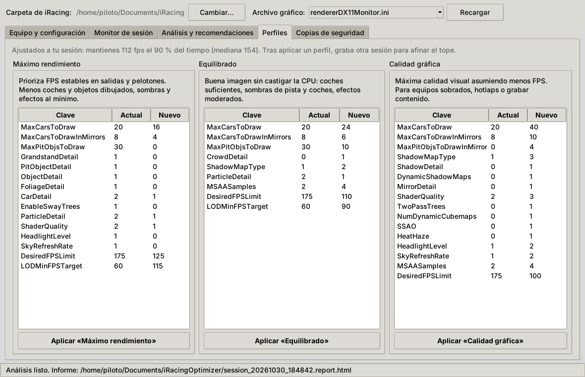
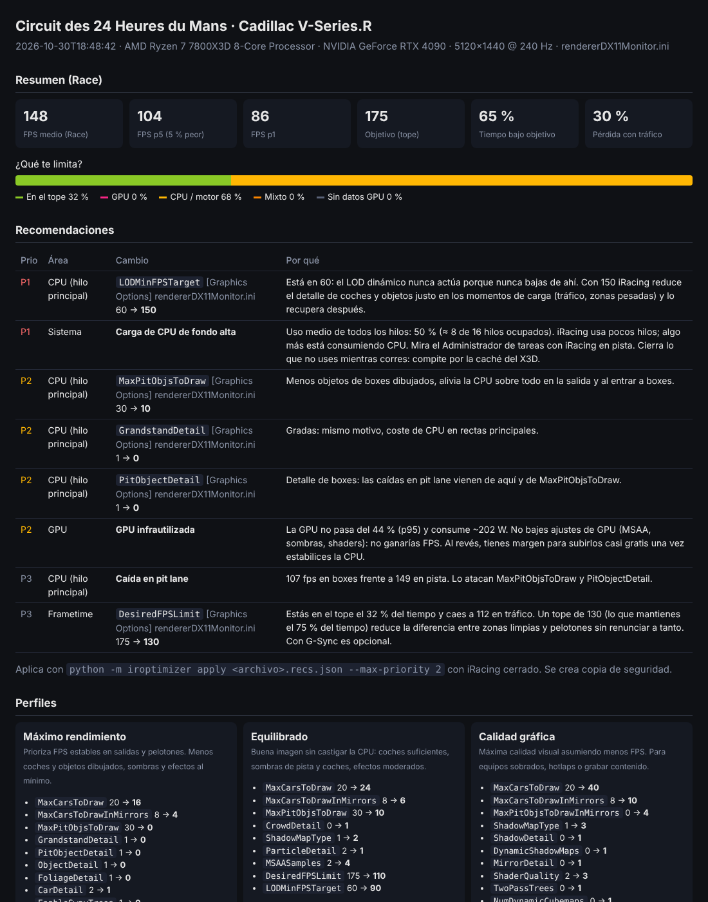
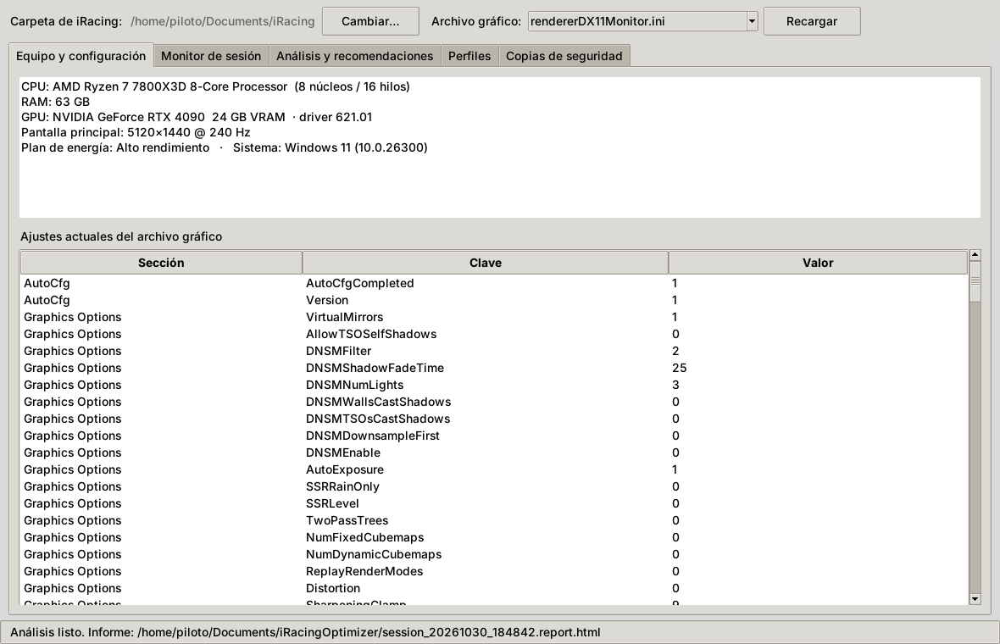

<p align="center"></p>

# iRacing Optimizer

Lee tu configuración de iRacing y de tu equipo y graba una sesión (mejor si es una carrera). Con eso te dice **qué te limita** (CPU/motor, GPU o el tope de FPS) y propone valores concretos para los `.ini`. Los cambios se aplican con un botón y siempre se guarda antes una copia de seguridad.



<details>
<summary>Más capturas</summary>

**Perfiles** (ajustados a la sesión medida)



**Informe HTML** (sesión real: carrera en Le Mans, 7800X3D + RTX 4090, 5120×1440)



**Equipo y configuración**



</details>

## Descarga

Descarga `iRacingOptimizer.exe` desde **[Releases](../../releases)** y ejecútalo: no necesita instalación ni Python.

> Windows SmartScreen puede avisar porque el ejecutable no está firmado. Pulsa "Más información → Ejecutar de todas formas".

## Uso

1. **Equipo y configuración**: detecta la carpeta `Documentos\iRacing`, el archivo gráfico (`rendererDX11Monitor.ini` u OpenXR para VR), la CPU, la GPU, la RAM y la pantalla.
2. **Monitor de sesión**: pulsa *Iniciar grabación*, entra a pista (lo ideal es una carrera completa) y pulsa *Detener* al terminar. Al acabar, analiza la sesión.
3. **Análisis y recomendaciones**: muestra los FPS medios, el 5 % y el 1 % peor, el porcentaje de tiempo bajo el objetivo, qué te limita y una lista de cambios priorizados (P1 aplicar ya, P2 recomendable, P3 opcional). Marca los que quieras y pulsa **Aplicar seleccionados**. Hay un informe HTML con gráficas.
4. **Perfiles**: tres configuraciones de partida (Máximo rendimiento, Equilibrado y Calidad gráfica). Si has analizado una sesión, el tope de FPS y el LOD dinámico se ajustan a tu medición. Cada perfil muestra exactamente qué cambia antes de aplicarlo.
5. **Comparar**: en Análisis, *Comparar con otra sesión…* enfrenta la sesión nueva con una anterior. Muestra los FPS según el tráfico (la comparación justa entre una práctica y una carrera) y qué ajustes cambiaron entre las dos.
6. **Copias de seguridad**: lista las copias y restaura cualquiera con un clic.

Aplica los cambios **con iRacing cerrado**, porque el simulador reescribe los `.ini` al salir. La app lo comprueba antes de escribir.

**Flujo recomendado:** graba una carrera → aplica las P1 → graba otra en la misma pista → compara → fija el tope de FPS con lo que mantienes el 90 % del tiempo.

## Qué mide

| Fuente | Datos |
|---|---|
| SDK de iRacing (4 Hz) | `FrameRate`, `CpuUsageFG/BG`, red (`Chan*`), fallos de página, posición en la vuelta y coches a menos de 150 m |
| Driver NVIDIA (NVML) | Uso real de GPU, VRAM, temperatura, frecuencia y consumo |
| Sistema | CPU por núcleo y total, RAM, memoria del proceso de iRacing y los procesos que más CPU consumen mientras conduces |
| `.ini` | `rendererDX11*.ini`, `app.ini`, `core.ini` (solo se modifican claves que ya existen) |

Para saber qué te limita usa la carga real de la GPU:
- Al **90 % o más**, el límite es la GPU.
- Por **debajo del 80 %**, la GPU está esperando frames y el límite es la CPU o el motor (hilo principal, draw calls).

Los FPS del SDK son una media de 1 s. Para medir microstutter (1 % / 0,1 % lows reales) graba a la vez con PresentMon y analiza con `--presentmon`.

## Línea de comandos

El mismo `.exe`, o `python -m iroptimizer`, acepta subcomandos:

```
iRacingOptimizer.exe scan
iRacingOptimizer.exe monitor --analyze
iRacingOptimizer.exe analyze sesion.csv [--target 165] [--presentmon pm.csv]
iRacingOptimizer.exe apply sesion.recs.json --max-priority 1 [--dry-run]
iRacingOptimizer.exe profile equilibrado [--from-session sesion.csv] [--dry-run]
iRacingOptimizer.exe compare antes.csv despues.csv
iRacingOptimizer.exe restore
iRacingOptimizer.exe demo
```

## Desarrollo

```bat
py -m pip install -r requirements.txt pytest
py -m pytest -q tests
py app.py            :: interfaz
build.bat            :: genera dist\iRacingOptimizer.exe
```

GitHub Actions compila el `.exe` en cada push a `main`; está disponible como *artifact* del workflow. Al publicar una Release (o subir una etiqueta `vX.Y.Z`), el workflow compila y adjunta el ejecutable:

```
gh release create v0.3.1 --generate-notes
```

### Estructura

```
app.py                  entrada del .exe (GUI sin argumentos, CLI con argumentos)
assets/                 logo (SVG), icono .ico y .png
docs/                   capturas del README
iroptimizer/
  gui.py                interfaz tkinter
  monitor.py            grabación (pyirsdk + psutil + NVML)
  analyzer.py           estadísticas, cuellos de botella, tráfico, zonas lentas
  recommender.py        reglas → cambios priorizados
  profiles.py           perfiles Rendimiento / Equilibrado / Calidad
  apply.py              aplicar, copias y restaurar
  iniio.py              lectura/escritura de .ini conservando comentarios
  config_reader.py      localiza Documentos\iRacing (respeta OneDrive)
  hardware.py           inventario del equipo
  report.py             informe HTML
```

## Limitaciones

- Umbrales calibrados con pocas sesiones (por ahora 7800X3D + RTX 4090). Para AMD Radeon no hay datos de carga de GPU (sin NVML), así que la clasificación es menos fiable.
- Los perfiles no tocan claves con rangos no documentados (por ejemplo `SSRLevel`) ni quitan espejos.
- No está afiliado a iRacing.com Motorsport Simulations.

## Licencia

MIT
